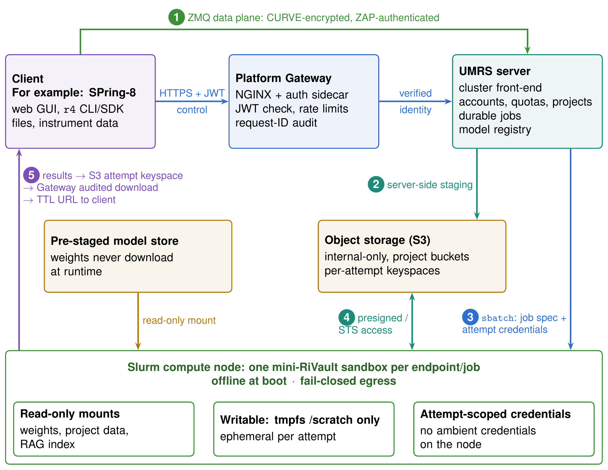

# AIMON

**AIMON: Connecting Scientific Data to On-Demand AI on Supercomputers** (RIKEN R-CCS, Inria).

AI for science should be ambient: models run automatically as scientific data (e.g. from facilities such as SPring-8) arrives on the supercomputer Rikyu (e.g. at R-CCS), and their outputs are queryable at any time.

## Components

### R4 (client)

CLI to list models, chat (`r4 chat`), and start/stop own sandboxed GPU endpoints (`r4 up` / `r4 down`).

### UMRS (server)

Reacts to data uploaded to an S3 bucket, calls a suitable model, stores the resulting embeddings in a relational DB.

### mini-RiVault (AI model serving)

Serves models (vLLM, BentoML + PyTorch) on demand inside an isolated Slurm job using rootless Podman.

## Pipeline

1. A scientist uploads data to an S3 bucket (using a client).
2. The upload triggers an event on the UMRS server.
3. UMRS sends mini-RiVault the input S3 address, model name, task/prompt, and output S3 bucket.
4. The model runs inference and writes the result to the whitelisted S3 bucket.
5. Embeddings are stored in a relational database and can be queried through R4.??????????

## Key features

- Multimodal: text, images, files.
- Zero human-in-the-loop after data upload.
- On-demand deployment of various models on GPU or CPU.
- Scales to large datasets and concurrent users.
- Secure, isolated user management.

## Security (mini-RiVault)

Threat model: the model server stack is assumed compromised; it must not be able to phone home or reach cluster-internal services.

- One door in: a single random high port behind Nginx, gated by a per-job bearer token.
- One door out: Nginx + CoreDNS DNS sinkhole; only the configured S3 bucket host resolves.
- Internal network without gateway or DNS; static IPs.
- Rootless Podman, all capabilities dropped, read-only mounts; models loaded from the cluster file system, not the internet.
- Ephemeral: per-job port and keys, full teardown on job exit.
- Known gap: no TLS between UMRS and Nginx (planned fix: self-signed certificate + HTTPS).

# Links

- AIMON --> https://github.com/r-ccs-hpais/aimon
- R4 --> https://github.com/R-CCS-HPBD/r4
- UMRS --> https://github.com/UMRS-org/umrs/
- mini-RiVault --> https://github.com/RIKEN-RCCS/RiVault

# Authors

- Emmanuel JEANNOT: Backend/Server -- [UMRS](https://github.com/UMRS-org/umrs/)
- Kento SATO, Masaru NAGASO: Client/frontend -- [R4](https://github.com/R-CCS-HPBD/r4)
- Jens DOMKE: AI model serving -- mini-[RiVault](https://github.com/RIKEN-RCCS/RiVault)
- Mohamed WAHIB, Emil VATAI: Models (+ assist on other parts)
